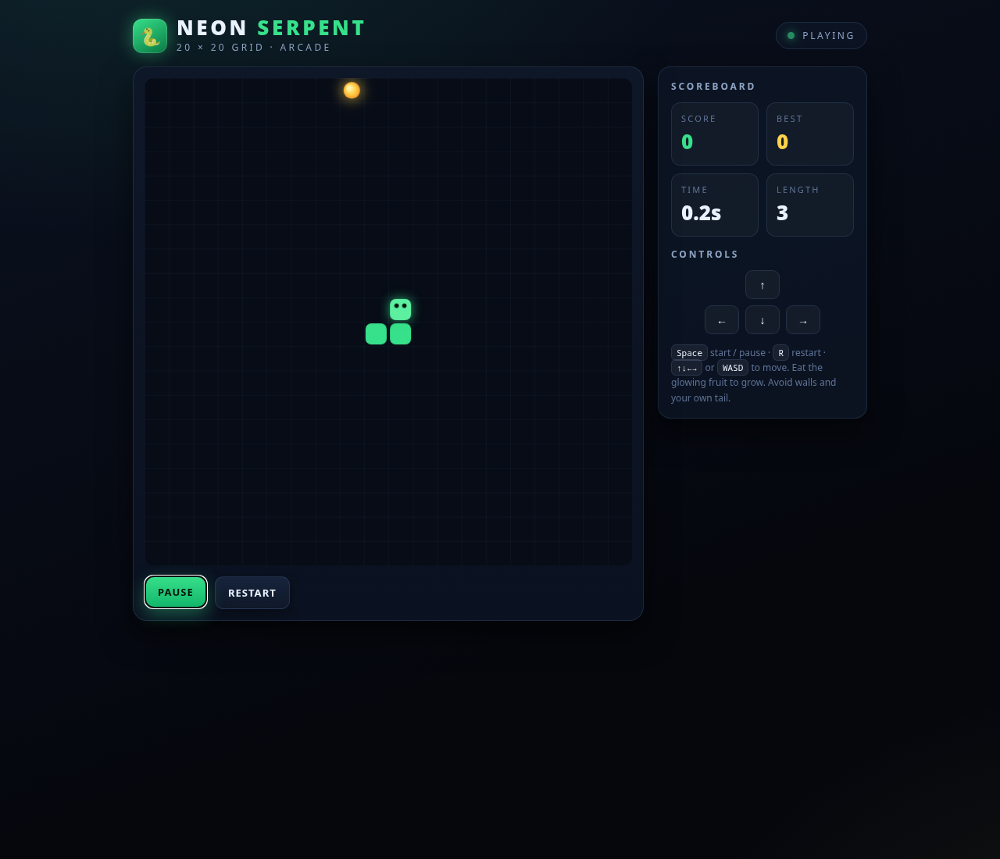
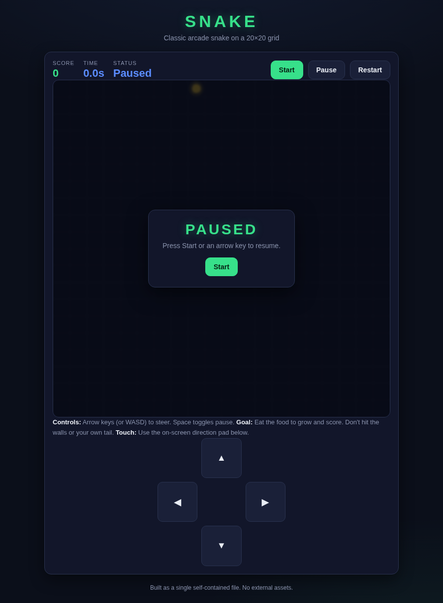
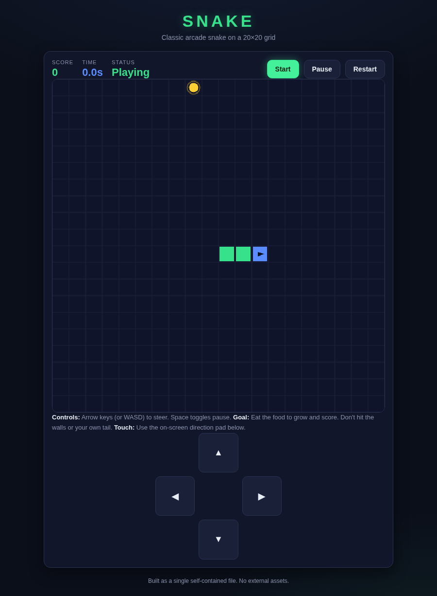
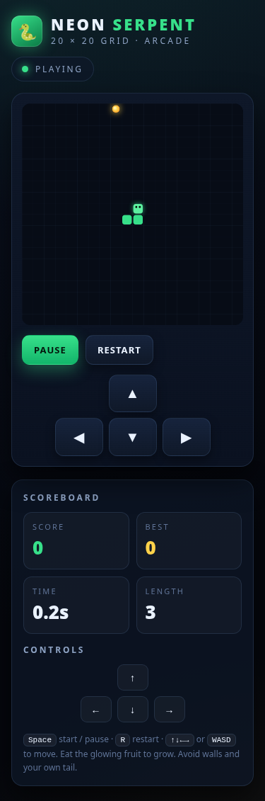

# Strata on an RX 9070 XT + 32 GB RAM

A personal fork of [Niko1221/Strata](https://github.com/Niko1221/Strata), tuned and tested
with **Qwen3.8-Flash-Next IQ3_XXS** and **Underdog-Saluki 27B IQ2-mix**, one 16 GB AMD GPU,
32 GB system RAM and an NVMe SSD. Saluki uses an experimental native dense engine path;
Flash-Next retains its separately tested 128K profile.

This fork adds an **opt-in hardware profile**, a memory-limited launcher, practical
benchmarks, a generate → independent review → revise workflow, and native dense Qwen35
engine support with adaptive GPU weights and KV storage. Dense support is opt-in; the
installed Flash-Next profile and ordinary installer defaults are retained. Model weights
are not included. The new native path was built and tested on HIP; CUDA and SYCL were not validated.



*An actual locally generated game, after two review rounds. Keyboard, mobile controls,
seeded food, growth and restart were checked. [Download the reviewed HTML](docs/examples/iq3_xxs/snake-reviewed.html)
and open it in your browser. Remaining issues are documented below.*

## The tested PC

Flash-Next measurements were recorded on **October 13, 2026**; native Saluki and
Qwen35 MoE measurements on **October 14, 2026**.

| Component | Tested configuration |
| --- | --- |
| GPU | AMD Radeon RX 9070 XT, 16 GiB VRAM, gfx1201 |
| CPU | Ryzen 7 7800X3D, 8 cores / 16 threads |
| RAM | 32 GB installed; 30.9 GiB reported by Linux |
| Storage | NVMe SSD, Btrfs |
| OS / runtime | CachyOS Linux, system ROCm 7.2 |
| Strata engine | Installed Flash engine 0.1.44; native dense development build based on 0.1.44 |
| Models | Flash-Next IQ3_XXS; Underdog-Saluki 27B IQ2-mix; experimental GSQ Qwen35 MoE |
| Serving | One model, one request at a time; screenshot input in separate dense profiles |

This is an NVMe-backed full-model configuration. The complete expert pack does not
fit in the GPU and resident RAM caches; misses read weights from SSD. The upstream
setup guide normally recommends more RAM for this model. These results do not cover
Windows, other GPUs or concurrent requests. Dense screenshot checks are recorded separately below.

## Native 27B: Saluki on the same PC

The tested dense model is **Underdog-Saluki-27B-1.0-IQ2-mix.gguf**, a 7.36 GiB file
with architecture `qwen35`. It runs inside Strata's native engine, using the original
Q2_K/IQ1_S weights. Its mmproj is not used: this profile is text-only.

| Final adaptive profile | Measurement or setting |
| --- | --- |
| Logical context limit | 262,144 tokens; starts with 4K KV allocation |
| Cache | int8 KV; grows with the conversation |
| GPU weights at load | About 7.41 GiB |
| Initial free VRAM | About 5.48 GiB reported by HIP |
| Short coding decode | 32.9–33.0 tokens/s, three greedy runs, 30 input / 192 output tokens |
| Snake generation | 32.3 tokens/s; 472 input / 5,503 output tokens; finished normally |
| Process-tree RAM after short runs | About 0.36 GiB systemd accounting; excludes VRAM and potentially global file cache |
| Guard | 20 GiB scope, zero scope swap, 1.5 GiB available-system-RAM threshold |

KV grows as needed, and GPU weight matrices move to the memory-mapped GGUF when space
gets tight. Transfers use two 8 MiB pinned staging buffers rather than a full pinned
host copy. Starting a fresh conversation shrinks KV and restores GPU weights where they
fit. The OS can cache source pages in RAM, so the process figure above is **not total
system memory usage**. Other GPU applications still compete for VRAM.

A fixed 256K allocation with about 4.84 GiB of staged weights managed only **3.5 tokens/s**
on a short request. Adaptive storage avoids that early transfer cost. Full 256K cache
allocation, eviction and restoration passed storage-pressure checks, but **a filled
256K language prompt has not been validated for speed or quality**. An earlier 160K
prefill was stopped after 72,704 tokens; it produced no answer. Expect throughput to
change when the growing cache forces weight staging.

### A Snake game generated by the 27B model

This is the unchanged Saluki output from the fixed practical prompt, with keyboard and
touch controls, score, pause and restart. It finished in about 174 seconds and ran with
no browser page errors. It passed **10/11 core checks**: the manual-step-while-paused
contract failed. Those checks establish specific behavior, not a full code-quality review.
This example demonstrates this particular model and quant on this hardware, not every 27B model.




[Download the self-contained game](bench/results/2026-10-14-native-saluki27/snake.html) ·
[Browser checks and generation report](bench/results/2026-10-14-native-saluki27/snake-report.json) ·
[Raw measurements and storage checks](bench/results/2026-10-14-native-saluki27/README.md)

### Run the local Saluki profile

After building the HIP development engine and preparing the tokenizer/profile using
[the native dense guide](docs/DENSE_QWEN35.md), this machine starts it with:

```sh
cd /home/garyb/Mounts/NVME/Strata
systemctl --user stop strata-local.scope
.venv/bin/python tools/dense_profile.py run --config strata-saluki27-adaptive.json
```

The config contains local model/tokenizer paths and is generated on your machine;
it is not bundled in Git. Cloning alone does not install weights or build the native
engine. The guide includes portable preparation commands, supported geometry and limitations.

The experimental GSQ Qwen35 MoE run also finished Snake at 87.7 tokens/s and passed
11/11 checks, but its visual quality was less polished in the user's assessment.
[Its separate measurements](bench/results/2026-10-14-native-qwen35-gsq/README.md) are retained.
Different models, quantization, output lengths and placement prevent treating these
rates as an engine-only comparison. Mixtral and DeepSeek support are not implemented;
see [model-family support](docs/MOE_MODEL_ADAPTERS.md).

## Flash-Next IQ3_XXS tuning

| Setting | This profile |
| --- | --- |
| Maximum context | 131,072 tokens |
| KV cache | int8; 32,768 resident cells per streamed layer |
| Host KV backing | About 1.55 GiB of pinned RAM allocated at startup |
| Resident expert budget | Up to 11 GiB, guarded page-locking |
| VRAM reserve | 3,072 MiB; automatic expert-cache and prefill sizing |
| File tier | Unbuffered NVMe reads |
| Overlap | Asynchronous adaptive expert swaps and automatic helper affinity |
| Process limit | systemd user scope: 20 GiB charged memory, zero process swap |

The profile keeps the model's MTP/speculation settings. The launcher bounds the server
and engine together and refuses an unprotected public bind. A separate test guard
stops the scope when available system RAM falls below 1 GiB.

An earlier uncontained configuration was OOM-killed. Higher-memory trials were faster
but left too little room for the desktop, so they were not retained. The current
review experiments kept at least **2.66 GiB available RAM** and did not trigger the guard.
The scope is not a guarantee against every GPU driver/kernel allocation or brief peak.
System swap, zram and drivers were not changed by this profile.

[Settings, tuning history and memory limits](docs/HARDWARE_RX9070XT_32GB.md)

## Measured generation speeds

These are real individual requests, not an advertised constant speed. Output lengths,
expert placement, SSD reads and draft acceptance differ between tasks. The writing
trials used temperature 0.7; the capability and context tests used temperature 0.

| IQ3_XXS task | Input / output tokens | Generation | Result |
| --- | ---: | ---: | --- |
| Short writing trials | 46 / 128 each | 15.4–38.0 tokens/s | Three trials; cold/warm behavior varied |
| Python interval merging | 308 / 329 | 12.4 tokens/s | 11/11 functional checks passed |
| Editable lighthouse SVG | 279 / 2,511 | 22.9 tokens/s | 7/7 structural checks; rendered successfully |
| Complete Snake game | 472 / 6,467 | 19.6 tokens/s | 11/11 gameplay checks; desktop/mobile controls worked |
| Full code-review revision | 7,482 / 7,083 | 14.2 tokens/s | Useful refactor, but introduced UI regressions |
| Focused review patch | 8,115 / 2,694 | 17.0 tokens/s | Working result; 11 core + 20 review-specific checks passed |

The first Snake attempt exhausted a 6,144-token cap. Raising the cap to 16,384 allowed
a new IQ3 attempt to finish. The focused patch returned nine literal edits, rather than
regenerating the entire file. [Practical comparisons and source review](docs/PRACTICAL_BENCHMARKS.md)

### Near-full 128K context

| Uncached input | Output | Prompt reading | Generation | Whole request |
| ---: | ---: | ---: | ---: | ---: |
| 65,547 tokens | 128 tokens | 431.7 tokens/s | 16.5 tokens/s | 159.6 s |
| 130,012 tokens | 128 tokens | 440.5 tokens/s | 28.0 tokens/s | 299.8 s |

The nearly full-window prompt took **295.1 seconds to read** and 4.6 seconds to generate
its short answer. It completed without an OOM or RAM-guard abort. These reference-summary
runs test capacity and throughput; they do not establish long-context answer quality.
The faster second result does not mean that larger context inherently increases speed.
**25–30 tokens/s happened in one near-full test; it is not sustained across every task.**

[Measurement JSON](docs/examples/iq3_xxs/measurements.json) ·
[Selected engine log lines](docs/examples/iq3_xxs/engine-excerpts.log)

Excerpt from the recorded engine output:

```text
strata generate: KV streaming: 32768 of 131072 cells per QSA layer in VRAM, the K/V in 1.55 GiB of pinned RAM
strata generate: the file tier reads unbuffered (STRATA_UNBUFFERED_LOAD=1)
strata serve: prompt 130012 tokens = 0 reused + 130012 read in 295115 ms (440.5 tok/s), 128 generated in 4567 ms (28.0 tok/s), drafts accepted 69 of 100, 6 checkpoints
```

## One endpoint, saved model profiles, and an AppImage

The optional router keeps the web UI and API at `http://127.0.0.1:8096/` while switching
between saved model profiles. Select a model in the dropdown and click **Load model**,
or let your harness request `saluki27` / `flash-iq3` through the same `/v1` base URL.
Only one model stays loaded; switching waits for generation to finish before releasing
its worker. **Release memory** unloads the model without stopping the router.

`GET /v1/models` lists all registered models, including unloaded profiles, with their
configured context length, output cap, modalities, sampling defaults and load status.
An output budget still has to fit after the input tokens in the shared context.


*Fresh-browser rendering check against the AppImage running Saluki; the screenshot is not a performance benchmark.*

On this machine, after registering the profiles:

```sh
./dist/Strata-RX9070XT-x86_64.AppImage --port 8096 --open --memory-floor-gib 3 --vram-floor-mib 512
```

The Linux x86_64 AppImage bundles Python, the server/web app, Flash and native dense HIP
engines, tuning tables and the expert-placement profile. Model weights/packs/tokenizers
remain external, and this first build requires compatible **system ROCm**. It is tested
on this PC, not claimed portable across all distributions or GPUs. The original single-model
server remains available separately. [Registration, API metadata, packaging and limits](docs/MODEL_ROUTER.md).
[Additional local profiles, active Swift MTP measurements and Tiel limitations](docs/LOCAL_MODEL_PROFILES.md).

Screenshot input is now available in separate Saluki and Swift profiles. The new
`saluki27-abliterated-mtp-vision` profile uses the embedded head, matching CPU image encoder,
and an adaptive 262,144-token limit. Two short screenshot checks measured **49.0–49.5
tokens/s with MTP**, versus **35.9–36.0 with drafting off**, with identical answers.
The older Swift MTP selections were removed from the local registry at the user's request.
[Screenshot profiles, setup, measurements and limits](docs/SCREENSHOT_INPUT.md).

Filled coding-context trials measured Saluki MTP at **37.2/35.4 tokens/s at roughly 32K**
and **16.7/15.8 at roughly 64K** for initial answer/cached follow-up. A later 4800 MT/s RAM
repeat completed at **32.8/30.4**, with no new kernel messages during that short run.
Two earlier system resets remain unresolved; these are performance/correctness samples,
not a long-duration stability guarantee. [Responses, prefill times, memory and limits](bench/results/2026-10-14-coding-context/README.md).

Saluki prefill tuning now measures **457 tokens/s on the 30,692-token coding prompt**,
up from **139** in the JEDEC baseline, with the same first answer and 13 passing checks.
The opt-in dense hipBLASLt table changes kernel selection without caching expanded
FP16 weights. [Measurements and configuration](docs/PREFILL_TUNING.md).
[Flash Next / Gyro comparison under investigation](docs/FLASH_GYRO_INVESTIGATION.md).

The existing Swift IQ3_S embedded-MTP model now measures **33.9/31.4 tokens/s**
for answer/cached review at 8K and **17.4/16.2 at 32K**, with screenshot input.
The opt-in memory fit retains the 256K ceiling, but uses an aggressive GPU reserve.
The 2048 MiB / two-draft trial later hit the VRAM guard after screenshot requests;
it is not yet a validated desktop-stable preset.
[Settings, measured VRAM headroom and checks](docs/SWIFT_IQ3_S_TUNING.md).

[Current results for all ten profiles, with test sizes and limitations](docs/MODEL_RESULTS.md).
The new opt-in Saluki path completed a **131,020-token coding prompt** with all 13
code checks and all three distant retrieval checks passing. It measured **302.3 tok/s
prefill, 19.7 tok/s generation and 18.0 tok/s cached review**, with at least 1,044 MiB
sampled free physical VRAM. This improves the first filled-128K trial (91.5 / 7.6 tok/s),
but does not yet meet the 25–30 tok/s target. The 256K ceiling and long-context image
requests remain unvalidated. [Settings, evidence and limitations](docs/SALUKI_128K.md).

## What it built

### A playable game, improved through review

The final Snake prototype has a DOM-free simulation factory, copied state snapshots,
deterministic food placement, a full-board win, accessible direction labels, mobile
scrolling and a loop that stops while paused. An independent cycle test filled the
400-cell board after 39,671 moves.



The first review-driven rewrite broke startup and pause controls. Independent review
caught those regressions; a second, focused patch fixed them. Minor follow-ups remain:
calling the new factory without a seed leaves food uninitialized, one pending callback
runs after death, and announcements use internal words such as “dead.” The unused engine
time field also remains. This is a useful prototype, not a claim of flawless code.

[Review/revision experiment, checks and timing](docs/REVIEW_REVISION_BENCHMARK.md)

### Editable vector artwork


The model wrote [this standalone SVG](docs/examples/iq3_xxs/lighthouse.svg) as code:
named sky/sea/lighthouse/beam layers, reusable gradients, title/description metadata,
no raster assets or external dependencies. It passed the specified palette and structure
checks. The illustration is clear but simple; this is SVG drafting, not raster image generation.

### Small library code

[The generated Python function](docs/examples/iq3_xxs/merge_intervals.py) merges touching
and overlapping intervals in O(n log n), preserves the input, and rejects malformed
intervals and boolean endpoints. It passed the 11 benchmark cases. Its outer-input
validation could still be more defensive. Tests and source review are both needed.

## Install this profile

Use an NVMe location with room for the download, pack and build. The two GGUF shards
are about **75.8 GB**, and the packed experts add about **40 GiB** plus dense weights,
MTP and build/cache files; allow at least 150 GB free for a fresh installation.

Follow [AI_SETUP.md](docs/AI_SETUP.md) and [AMD_HIP.md](docs/AMD_HIP.md) for the normal
installer and AMD runtime prerequisites. This is an explicit, opt-in 32 GB file-tier
experiment; apply the bounded profile before starting the model.

```sh
git clone --branch codex/rx9070xt-32gb-profile https://github.com/pwnedbygary/Strata.git
cd Strata
./setup.sh --yes --family qwen --model IQ3_XXS --context 131072 --no-start
.venv/bin/python tools/hardware_profile.py apply --config strata-iq3_xxs.json
.venv/bin/python tools/hardware_profile.py run \
  --config strata-iq3_xxs-rx9070xt-32gb.json --port 8096 --open
```

Linux, a systemd user manager and cgroup v2 memory accounting are required by the
bounded launcher. The helper preserves model paths and writes a separate configuration.
The server is local at `http://127.0.0.1:8096/`, with an OpenAI-compatible API at `/v1`
and an Anthropic-compatible API at `/v1/messages`. A public bind requires an API key.

Stop the server with:

```sh
systemctl --user stop strata-local.scope
```

`experts.bin` is the packed expert-weight file used by this setup, not swap or chat
history. Keep it: the NVMe file tier depends on it. The GGUFs, pack and MTP are excluded
from Git and are not downloaded by cloning this fork.

## Repeat the practical tests

Run one client at a time against the already-running server. Keep prompt, sampling,
output budget and review mode consistent. The reports retain failed attempts too.

```sh
.venv/bin/python tools/hardware_profile.py benchmark \
  --cases merge_intervals,lighthouse_svg --output-dir benchmark-results/iq3-code-art
.venv/bin/python tools/hardware_profile.py benchmark \
  --cases snake --max-tokens 16384 --output-dir benchmark-results/iq3-snake
```

Add `--browser-checks` after installing the optional Playwright dependencies in
[the practical suite guide](bench/practical/README.md). Use the
[review-driven runner](docs/REVIEW_REVISION_BENCHMARK.md) to provide an actual source
review and measure whether a revision fixes findings without introducing regressions.
The request protocol uses fixed prompts and seeds; adaptive placement means outputs
are not guaranteed bit-identical across runs or hardware.

Helper tests need no model, GPU or downloads:

```sh
python3 -m unittest tools.test_hardware_profile tools.test_practical_checks tools.test_benchmark_revision
```

## Evidence and upstream credit

- [Exported examples, measurements and logs](docs/examples/iq3_xxs/README.md)
- [Hardware profile and tuning history](docs/HARDWARE_RX9070XT_32GB.md)
- [Experimental native dense Qwen35 27B support](docs/DENSE_QWEN35.md)
- [Practical model comparisons](docs/PRACTICAL_BENCHMARKS.md)
- [Independent review and revision results](docs/REVIEW_REVISION_BENCHMARK.md)
- [Original upstream README](README.upstream.md), [engine details](docs/DETAILS.md),
  [model guide](docs/MODELS.md) and [MIT license](LICENSE)

The inference engine, server, installer and original project belong to
[Niko1221 and the Strata contributors](https://github.com/Niko1221/Strata).
This fork contributes optional hardware profiles, native dense Qwen35 extensions,
measurement tools, the review workflow and these hardware-specific results. Other translated READMEs describe the upstream project.
