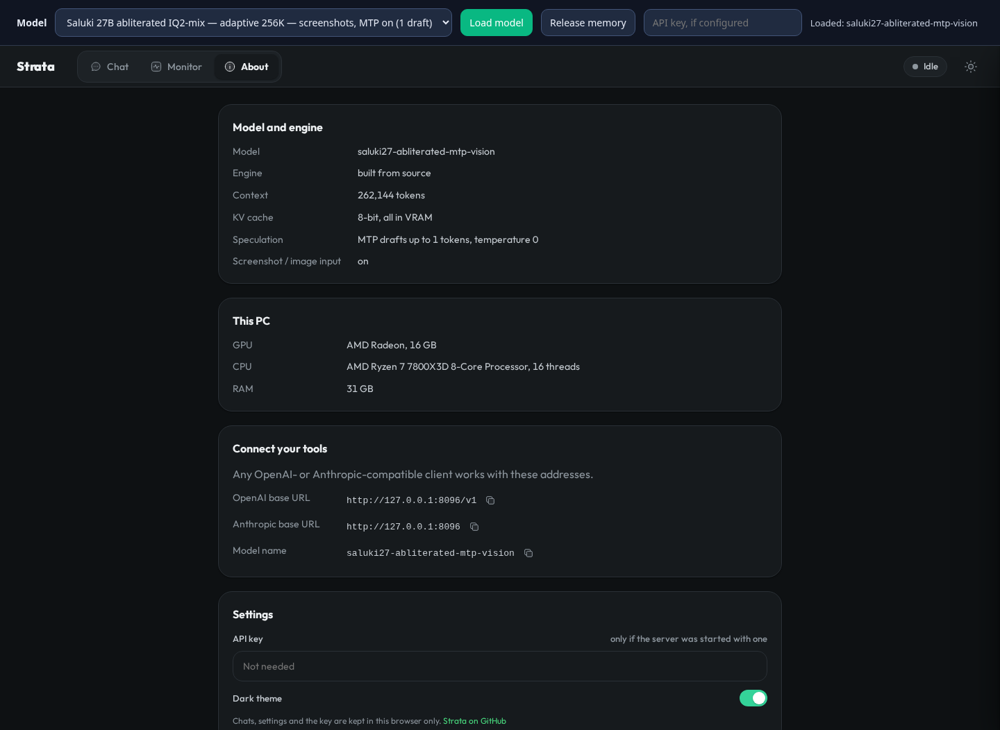

# Screenshot input on the RX 9070 XT profile

The optional dense image path was tested October 14, 2026 on an RX 9070 XT 16 GiB,
Ryzen 7800X3D, 32 GB RAM and ROCm 7.2. It accepts screenshot/image input through the
existing chat attachment control and OpenAI `image_url` content parts. It does not
generate images. The matching mmproj is an image encoder/projector, not another LLM.

Separate profiles keep the encoder out of text-only workers. The CPU encoder uses four
threads and a 2,048 visual-token budget per image. Increase `--vision-tokens` up to 4,096
when registering profiles if small text needs more resolution; encoding costs more time
and host memory. Visual tokens count toward the context, alongside text and output.

| API model ID | Context limit | Drafting | Two screenshot responses |
| --- | ---: | --- | --- |
| `saluki27-vision` | 262,144 | Off | 34.2–34.3 tokens/s |
| `swift27-iq3-xxs-vision` | 262,144 | Off | 33.5 tokens/s |
| `swift27-iq3-s-vision` | 262,144 | Off | 14.5–14.7 tokens/s |
| `saluki27-abliterated-vision` | 262,144 | Off | 35.9–36.0 tokens/s |
| `saluki27-abliterated-mtp-vision` | 262,144 | One draft, greedy | 49.0–49.5 tokens/s |

These are short 242-input-token OCR requests, not sustained coding or filled-window
measurements. Every profile copied the filename, line number, error code and message
correctly from two different 640×320 fixtures with the same dimensions. Saluki abliterated
produced identical complete assistant messages with MTP on/off; all 26 offered drafts
were accepted in each MTP response. [Raw fixtures, responses and comparison](../bench/results/2026-10-14-vision/README.md).

The embedded head consumes the same projected image embeddings and interleaved rotary
positions as the main model. MTP is greedy-only: a nonzero temperature disables drafting.
With drafting off, the embedded head is not loaded into VRAM. Original GGUF files remain
unchanged. Neither abliterating a model nor this OCR check establishes its general quality.



The About view above was checked against the running AppImage after the JEDEC comparison;
it rendered without page errors. The context number is the configured limit, not the current fill.

The dense path currently starts a fresh model context for every image-containing request,
including repeated pictures. The CPU encoder caches pictures, but the LLM prompt is
prefilled again. Text-only continuations can reuse the existing prefix. Changed pictures
were tested to avoid stale answers. Image-prefix reuse remains a performance limitation
for long screenshot-heavy conversations.

## Register and run

Build the optional CPU encoder and bundle it with the native dense engine:

```sh
cmake -S tools/vision -B build-vision -G Ninja -DCMAKE_BUILD_TYPE=Release
cmake --build build-vision --target strata-vision -j2
.venv/bin/python tools/build_appimage.py \
  --appimagetool /absolute/path/to/appimagetool \
  --vision-engine build-vision/bin/strata-vision
.venv/bin/python tools/local_model_profiles.py \
  --vision --saluki-abliterated --remove-swift-mtp
./dist/Strata-RX9070XT-x86_64.AppImage --open
```

The Saluki variants use `mmproj-Underdog-Saluki-27B-1.0-F16.gguf`; Swift uses its own
matching projector. Weights and projectors stay in the external `models/` directory.
The local CPU encoder was built for this CPU; this package is not a universal Linux release.
Refresh the router after restarting, select the desired `-vision` profile, and load it.
About reports **Screenshot / image input: on**. `/v1/models` advertises text/image input,
the configured context limit and drafting state for harnesses.

The 256K setting is a logical capacity, not a completed 256K image/coding quality test.
Keep fresh prefill time, cached follow-up time, decode speed and answer correctness separate.
The completed [coding-context checks](../bench/results/2026-10-14-coding-context/README.md)
measured Saluki MTP at 37.2/35.4 tokens/s at roughly 32K, and 16.7/15.8 at roughly 64K
for first answer/follow-up. Fresh prefill took 3.2 and 8.9 minutes respectively; cached
text follow-ups began responding in 0.82 and 1.10 seconds. Both requests generated complete
function fixes that passed thirteen targeted checks. These filled requests did not include images.
After BIOS memory/fabric settings were reset and Curve Optimizer removed, a 4800 MT/s
repeat completed at 32.8/30.4 tokens/s with no new kernel messages during the run. The
earlier unexpected system resets remain an unresolved platform-stability limitation.
The worker's 20 GiB/no-swap limit and 1.5 GiB available-RAM guard remain active. GPU memory
also competes with other applications; allocator-reported reserve differs from physical
free VRAM reported by the driver. CUDA and SYCL were not built or tested here.
